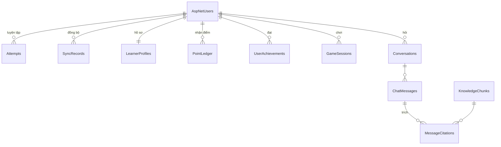

# Thiết kế cơ sở dữ liệu EnglishUp

Đề xuất cho đề tài "Xây dựng ứng dụng EnglishUp hỗ trợ học tiếng Anh với trợ giảng AI dựa trên RAG". Bảng đánh dấu **Đã có** nằm trong migration hiện tại; bảng **Đề xuất** sẽ được thêm theo lộ trình trong [PLAN.md](../PLAN.md) và có thể điều chỉnh khi cài đặt.

## 1. Nguyên tắc

- **Local-first.** Trình duyệt lưu dữ liệu học trong IndexedDB (Dexie) và học được khi không có mạng. PostgreSQL trên Supabase giữ bản của tài khoản, tính điểm, bảng xếp hạng và phục vụ trợ giảng.
- **Không tin dữ liệu từ trình duyệt.** Server kiểm tra mọi payload, tự tính điểm và tự chấm trò chơi.
- **Dữ liệu thuộc về người học.** Mọi bảng dữ liệu cá nhân có khoá ngoại tới `AspNetUsers` với `ON DELETE CASCADE`. Bảng xếp hạng chỉ hiện tên hiển thị của người đã đồng ý.
- **Không lưu âm thanh, không lưu khoá API** trong cơ sở dữ liệu. Khoá AI nằm trong user-secrets hoặc biến môi trường của server.
- **Nền tảng:** PostgreSQL do Supabase quản lý, truy cập qua EF Core 9 (Npgsql) từ API ASP.NET Core. Trình duyệt không gọi Supabase trực tiếp; chuỗi kết nối chỉ nằm ở server (user-secrets hoặc biến môi trường). Tìm kiếm vector dùng extension `pgvector` có sẵn trên Supabase. Không dùng Supabase Auth, REST tự sinh hay Row Level Security: ASP.NET Identity và API giữ toàn bộ quy tắc.

## 2. Tổng quan

| Nhóm                    | Bảng                                                                                                                            | Trạng thái              |
| ----------------------- | ------------------------------------------------------------------------------------------------------------------------------- | ----------------------- |
| Tài khoản               | `AspNetUsers`, `AspNetRoles`, `AspNetUserRoles`, `AspNetUserClaims`, `AspNetRoleClaims`, `AspNetUserLogins`, `AspNetUserTokens` | Đã có (`InitialCreate`) |
| Đồng bộ học tập         | `Attempts`, `SyncRecords`                                                                                                       | Đã có (`InitialCreate`) |
| Hồ sơ, điểm, thành tích | `PointLedger` (`AddPoints`), `LearnerProfiles`, `UserAchievements` (`AddCommunity`)                                             | Đã có                   |
| Trò chơi                | `GameSessions` (`AddGame`)                                                                                                      | Đã có                   |
| Trợ giảng RAG           | `KnowledgeChunks`, `Conversations`, `ChatMessages`, `MessageCitations`                                                          | Đã có (tuần 5–6)        |
| Quản trị, hiện diện     | `Presence` (`AddPresence`); vai trò `Admin` trong `AspNetRoles`/`AspNetUserRoles`                                               | Đã có                   |
| Tài liệu học tập        | `ContentItems` (`AddContentItems`)                                                                                              | Đã có                   |



## 3. Từ điển dữ liệu

Ký hiệu: PK khoá chính, FK khoá ngoại, NN không null, UQ duy nhất.

### 3.1 Tài khoản — Đã có

Do ASP.NET Identity tạo. Các cột dùng tới:

| Cột (`AspNetUsers`)               | Kiểu             | Ràng buộc                          | Ghi chú                            |
| --------------------------------- | ---------------- | ---------------------------------- | ---------------------------------- |
| `Id`                              | text             | PK                                 | GUID dạng chuỗi                    |
| `Email`, `NormalizedEmail`        | varchar(256)     | UQ (cấu hình `RequireUniqueEmail`) | Không hiện công khai               |
| `PasswordHash`                    | text             |                                    | Băm PBKDF2, không lưu mật khẩu gốc |
| `AccessFailedCount`, `LockoutEnd` | int, timestamptz |                                    | Khoá tạm khi nhập sai nhiều lần    |

Role, claim, login ngoài và token chưa dùng nhưng được Identity tạo sẵn.

### 3.2 `Attempts` — Đã có

Mỗi lượt luyện tập đã lưu. Tách cột để truy vấn điểm theo ngày và kỹ năng.

| Cột                | Kiểu             | Ràng buộc                       | Ghi chú                                                     |
| ------------------ | ---------------- | ------------------------------- | ----------------------------------------------------------- |
| `UserId`           | text             | PK, FK → `AspNetUsers`, cascade |                                                             |
| `Id`               | varchar(128)     | PK                              | UUID do trình duyệt sinh; gửi lại không tạo bản trùng       |
| `Skill`            | varchar(16)      | NN                              | `vocabulary`, `listening`, `speaking`, `reading`, `writing` |
| `Score`            | double precision | NN, 0–100 (kiểm tra ở API)      |                                                             |
| `Duration`         | double precision | NN, ≥ 0                         | Giây                                                        |
| `Timestamp`        | double precision | NN, ≥ 0                         | Mili-giây Unix từ JavaScript                                |
| `Label`            | varchar(500)     | NN                              | Tên bài/từ                                                  |
| `LearningLanguage` | varchar(8)       | null                            | `en`, `ja`, `zh`                                            |

Index: `IX_Attempts_UserId_Timestamp`.

### 3.3 `SyncRecords` — Đã có

Sáu kho Dexie còn lại (`settings`, `words`, `reviews`, `drafts`, `submissions`, `vocabularyStudy`), mỗi bản ghi lưu nguyên dạng JSON.

| Cột       | Kiểu             | Ràng buộc                       | Ghi chú                                                       |
| --------- | ---------------- | ------------------------------- | ------------------------------------------------------------- |
| `UserId`  | text             | PK, FK → `AspNetUsers`, cascade |                                                               |
| `Store`   | varchar(32)      | PK                              | Thuộc danh sách sáu kho                                       |
| `Id`      | varchar(128)     | PK                              | Khoá của bản ghi trong Dexie                                  |
| `Version` | double precision | NN, ≥ 0                         | `updated`, `lastReviewed` hoặc `timestamp`; bản cao hơn thắng |
| `Data`    | text             | NN, object JSON ≤ 200.000 ký tự | Client kiểm tra lại bằng Zod khi nhận về                      |

Lý do dùng JSON: server chỉ giữ hộ và gộp các kho này, không truy vấn bên trong; client thêm trường không cần migration. Khi cần truy vấn một trường (ví dụ số từ đã thuộc), tách kho đó thành bảng riêng giống `Attempts`.

### 3.4 `LearnerProfiles` — Đã có (`AddCommunity`)

| Cột                 | Kiểu        | Ràng buộc                       | Ghi chú                                          |
| ------------------- | ----------- | ------------------------------- | ------------------------------------------------ |
| `UserId`            | text        | PK, FK → `AspNetUsers`, cascade | Quan hệ 1–1, tạo khi cần lần đầu                 |
| `DisplayName`       | varchar(40) | NN, 2–40 ký tự in được          | Mặc định "Học viên" + 4 chữ số ngẫu nhiên        |
| `ShowOnLeaderboard` | boolean     | NN, mặc định false              | Người học tự bật; bảng xếp hạng không hiện email |
| `CreatedAt`         | timestamptz | NN                              |                                                  |

Chưa có cột múi giờ: mọi người học dùng giờ Việt Nam (`Asia/Ho_Chi_Minh`) cho "một ngày", giới hạn điểm, chuỗi ngày học và tuần của bảng xếp hạng. Thêm cột `TimeZone` khi có người học ở nước ngoài.

### 3.5 `PointLedger` — Đã có (`AddPoints`)

Sổ ghi điểm: mỗi dòng là một lần cộng điểm. Tổng điểm và bảng xếp hạng đều tính từ bảng này nên luôn kiểm tra lại được.

| Cột         | Kiểu            | Ràng buộc                       | Ghi chú                                           |
| ----------- | --------------- | ------------------------------- | ------------------------------------------------- |
| `Id`        | bigint identity | PK                              |                                                   |
| `UserId`    | text            | NN, FK → `AspNetUsers`, cascade |                                                   |
| `Source`    | varchar(16)     | NN                              | `attempt`, `game`, `achievement`                  |
| `SourceId`  | varchar(128)    | NN                              | Id lượt luyện tập, Id ván chơi hoặc mã thành tích |
| `Points`    | int             | NN, > 0                         |                                                   |
| `LocalDate` | date            | NN                              | Ngày theo giờ Việt Nam                            |
| `CreatedAt` | timestamptz     | NN                              | Giờ server                                        |

- UQ (`UserId`, `Source`, `SourceId`): một nguồn chỉ được cộng điểm một lần, dù đồng bộ lại bao nhiêu lần.
- Index (`UserId`, `LocalDate`) để tính điểm trong ngày.

### 3.6 `UserAchievements` — Đã có (`AddCommunity`)

Danh mục huy hiệu và điều kiện đạt viết trong code C# (`Community.cs`); tên và mô tả song ngữ nằm ở client vì là chữ giao diện. Không cần bảng `Achievements`.

| Mã               | Điều kiện                                 | Điểm thưởng |
| ---------------- | ----------------------------------------- | ----------- |
| `first-practice` | Có ít nhất 1 lượt luyện tập               | 10          |
| `streak-3`       | 3 ngày liên tiếp có luyện tập             | 20          |
| `streak-7`       | 7 ngày liên tiếp có luyện tập             | 50          |
| `all-skills`     | Đã luyện đủ 5 kỹ năng                     | 30          |
| `perfect-10`     | 10 lượt đạt 100%                          | 30          |
| `words-100`      | 100 bản ghi `reviews` trong `SyncRecords` | 50          |

| `UserAchievements` | Kiểu        | Ràng buộc                       |
| ------------------ | ----------- | ------------------------------- |
| `UserId`           | text        | PK, FK → `AspNetUsers`, cascade |
| `Code`             | varchar(32) | PK                              |
| `EarnedAt`         | timestamptz | NN                              |

Huy hiệu được xét sau mỗi lần đồng bộ, dựa trên lịch sử đã lưu; mỗi huy hiệu chỉ đạt một lần nhờ khoá chính ghép.

### 3.7 `GameSessions` — Đã có (`AddGame`, `GameModes`)

Trò chơi trắc nghiệm 60 giây. Server rút 60 từ (lọc theo trình độ nếu chọn) từ `vocabulary.json` và `vocabulary-it.json` của client (liên kết vào thư mục output của API), tạo 4 lựa chọn nghĩa tiếng Việt, tính giờ và chấm **từng câu**; đáp án không bao giờ gửi cho trình duyệt.

| Cột                            | Kiểu        | Ràng buộc                       | Ghi chú                                                                                                                                  |
| ------------------------------ | ----------- | ------------------------------- | ---------------------------------------------------------------------------------------------------------------------------------------- |
| `Id`                           | uuid        | PK                              | Server cấp khi bắt đầu                                                                                                                   |
| `UserId`                       | text        | NN, FK → `AspNetUsers`, cascade |                                                                                                                                          |
| `Level`                        | varchar(8)  | null                            | `A1`–`C2`, null = mọi trình độ                                                                                                           |
| `Mode`                         | varchar(16) | NN, mặc định `vocabulary`       | `vocabulary` (chọn nghĩa) hoặc `grammar` (điền chỗ trống); kỷ lục và bảng xếp hạng tính riêng theo chế độ; chỉ mục (`Mode`, `StartedAt`) |
| `QuestionsJson`                | text        | NN                              | Id từ, từ, 4 lựa chọn và chỉ số đáp án                                                                                                   |
| `StartedAt`                    | timestamptz | NN                              | Giờ server; câu trả lời sau `StartedAt + 60 giây + 3 giây` bị từ chối (409)                                                              |
| `FinishedAt`                   | timestamptz | null                            | Đặt khi kết thúc; kết thúc lại trả cùng kết quả                                                                                          |
| `Answered`                     | int         | NN, concurrency token           | Câu phải trả lời theo thứ tự; hai câu trả lời cùng lúc cho một câu chỉ tính một                                                          |
| `Correct`, `Combo`, `MaxCombo` | int         | NN                              |                                                                                                                                          |
| `Score`                        | int         | null cho đến khi kết thúc       | `10 × Correct + 5 × MaxCombo`                                                                                                            |

Index (`UserId`, `StartedAt`). Kỷ lục cá nhân = `MAX(Score)`; số ván đã chơi = số ván có `Score`.

### 3.8 Trợ giảng RAG — Đã có

`KnowledgeChunks` chứa nội dung học của chính ứng dụng, mỗi mục một đoạn: 2.080 từ vựng, 6 bài đọc, 6 bài nghe, 10 đề viết và 100 cấu trúc câu (`grammar`). Lệnh `dotnet run --project EnglishUp.Api -- ingest` tạo embedding cho các đoạn mới hoặc đã đổi và xoá đoạn không còn trong nội dung.

| Cột              | Kiểu          | Ràng buộc | Ghi chú                                                         |
| ---------------- | ------------- | --------- | --------------------------------------------------------------- |
| `Id`             | int identity  | PK        |                                                                 |
| `SourceType`     | varchar(16)   | NN        | `word`, `reading`, `listening`, `writing-guide`…                |
| `SourceId`       | varchar(128)  | NN        | Id trong file JSON nội dung, để mở đúng bài khi trích nguồn     |
| `Title`          | varchar(200)  | NN        | Hiện trong phần nguồn trích dẫn                                 |
| `Text`           | varchar(4000) | NN        | Một đoạn khoảng 100–300 từ                                      |
| `ContentHash`    | char(64)      | NN        | SHA-256 của `Text`; chỉ tạo lại embedding khi nội dung đổi      |
| `EmbeddingModel` | varchar(64)   | NN        | Hiện là `gemini-embedding-2`; đổi mô hình thì tạo lại embedding |
| `Embedding`      | vector(768)   | NN        | Kiểu của pgvector; 768 chiều của `gemini-embedding-2`           |

- UQ (`SourceType`, `SourceId`): mỗi mục nội dung đúng một đoạn; `ContentHash` quyết định có tạo lại embedding hay không.
- Ước tính vài nghìn đoạn; ví dụ 5.000 đoạn × 768 chiều × 4 byte ≈ 15 MB, pgvector tìm theo khoảng cách cosine ngay trong SQL, có index HNSW (`vector_cosine_ops`).

| `Conversations` | Kiểu        | Ràng buộc                                                                                 |
| --------------- | ----------- | ----------------------------------------------------------------------------------------- |
| `Id`            | uuid        | PK                                                                                        |
| `UserId`        | text        | NN, FK → `AspNetUsers`, cascade                                                           |
| `CreatedAt`     | timestamptz | NN                                                                                        |
| `DeletedAt`     | timestamptz | NULL: người học xoá thì nội dung tin nhắn bị xoá trắng, dòng vẫn giữ để đếm giới hạn ngày |

| `ChatMessages`   | Kiểu            | Ràng buộc                         | Ghi chú                            |
| ---------------- | --------------- | --------------------------------- | ---------------------------------- |
| `Id`             | bigint identity | PK                                |                                    |
| `ConversationId` | uuid            | NN, FK → `Conversations`, cascade |                                    |
| `Role`           | varchar(16)     | NN                                | `user` hoặc `assistant`            |
| `Content`        | varchar(4000)   | NN                                | Câu hỏi giới hạn 1.000 ký tự ở API |
| `CreatedAt`      | timestamptz     | NN                                |                                    |

| `MessageCitations` | Kiểu             | Ràng buộc                           | Ghi chú                                                 |
| ------------------ | ---------------- | ----------------------------------- | ------------------------------------------------------- |
| `MessageId`        | bigint           | PK, FK → `ChatMessages`, cascade    | Tin nhắn của trợ giảng                                  |
| `ChunkId`          | int              | PK, FK → `KnowledgeChunks`, cascade | Ingest xoá đoạn cũ thì trích dẫn đi theo                |
| `Rank`             | int              | NN                                  | Số [n] dùng trong câu trả lời; chỉ lưu nguồn được trích |
| `Score`            | double precision | NN                                  | Độ tương đồng cosine, dùng khi đánh giá RAG             |

- Mỗi người hỏi tối đa 20 câu mỗi ngày (giờ Việt Nam), đếm theo `ChatMessages` có `Role = user`.

## 4. Quy tắc nghiệp vụ gắn với dữ liệu

**Điểm (giá trị khởi đầu, chỉnh sau khi chạy thử):**

- Mỗi lượt luyện tập mới đồng bộ lên: `1 + floor(Score / 25)` điểm (1–5).
- Trò chơi: điểm ván `10 × câu đúng + 5 × combo cao nhất`, do server chấm; điểm tích luỹ = điểm ván / 10 (nguồn `game`, `SourceId` = Id ván).
- Thành tích: cộng điểm thưởng của huy hiệu một lần, **không** tính vào giới hạn ngày.
- Giới hạn 300 điểm mỗi `LocalDate` cho nguồn `attempt` và `game`, để không cày điểm bằng các lượt ngắn.
- Lượt có `Timestamp` cũ hơn 7 ngày khi đồng bộ vẫn được lưu nhưng không cộng điểm, để không nhập file sao lưu cũ lấy điểm.

**Bảng xếp hạng tuần** (không cần bảng riêng):

```sql
SELECT p."DisplayName", SUM(l."Points") AS points
FROM "PointLedger" AS l
JOIN "LearnerProfiles" AS p ON p."UserId" = l."UserId" AND p."ShowOnLeaderboard"
WHERE l."LocalDate" >= @week_start AND l."LocalDate" < @week_start + 7
GROUP BY l."UserId", p."DisplayName"
ORDER BY points DESC
LIMIT 50;
```

**Gợi ý cá nhân hoá** đọc trực tiếp từ dữ liệu đã có: kỹ năng có điểm trung bình thấp trong `Attempts`, số thẻ đến hạn trong bản ghi `reviews` của `SyncRecords`, chủ đề đang học trong `vocabularyStudy`. Không cần bảng mới.

## 5. Dữ liệu phía trình duyệt (Dexie)

Định nghĩa trong [storage.ts](../src/services/storage.ts): `settings`, `attempts`, `words`, `reviews`, `drafts`, `submissions`, `vocabularyStudy`. Điểm, thành tích, bảng xếp hạng và lịch sử trợ giảng **chỉ ở server**, không đưa vào Dexie hay file sao lưu, vì đó là dữ liệu do server quyết định.

## 6. Lộ trình migration

| Tuần | Migration                               | Bảng                                                                                                    |
| ---- | --------------------------------------- | ------------------------------------------------------------------------------------------------------- |
| 1–2  | `InitialCreate`                         | `AspNet*`, `Attempts`, `SyncRecords` (đã có)                                                            |
| 1    | `AddPoints`                             | `PointLedger` (đã có)                                                                                   |
| 2    | `AddCommunity`                          | `LearnerProfiles`, `UserAchievements` (đã có)                                                           |
| 3    | `AddGame`                               | `GameSessions` (đã có)                                                                                  |
| 5    | `AddKnowledge` (bật extension `vector`) | `KnowledgeChunks` (đã có)                                                                               |
| 6    | `AddAssistant`                          | `Conversations`, `ChatMessages`, `MessageCitations` (đã có); `SoftDeleteConversations` thêm `DeletedAt` |

## 7. Hạn chế đã biết

- Đồng bộ không có bản ghi xoá (tombstone): xoá từ tự thêm hoặc đặt lại dữ liệu chỉ có tác dụng trên một thiết bị.
- Phiên bản bản ghi dựa vào đồng hồ của thiết bị; đồng hồ sai có thể làm bản cũ thắng.
- Mỗi lần đồng bộ trả toàn bộ dữ liệu tài khoản; cần con trỏ "từ thời điểm" khi lịch sử lớn.
- Gói miễn phí của Gemini cho 100 embedding mỗi phút và 1.000 mỗi ngày cho cả server; mỗi lần tìm kiếm dùng một lượt, nên khi hết lượt người dùng nhận lỗi 503. Lần ingest đầu (khoảng 2.100 đoạn) phải chạy trong ba ngày.
- Đăng xuất chưa thu hồi token phía server.

### `Presence` — Đã có (`AddPresence`)

Lần cuối mỗi tài khoản mở app. Trình duyệt gửi `POST /api/presence` mỗi phút khi đã đăng nhập và tab đang hiển thị; trang quản trị coi người được thấy trong 2 phút gần nhất là online.

| Cột          | Kiểu        | Ràng buộc                             | Ghi chú                   |
| ------------ | ----------- | ------------------------------------- | ------------------------- |
| `UserId`     | text        | PK, FK → `AspNetUsers` (1–1), cascade |                           |
| `LastSeenAt` | timestamptz | NN, chỉ mục                           | Giờ UTC của nhịp gần nhất |

Quản trị viên là tài khoản thuộc vai trò `Admin` (bảng có sẵn của Identity), cấp bằng `dotnet run --project EnglishUp.Api -- admin <email>` và thu hồi bằng `--remove`.

### `ContentItems` — Đã có (`AddContentItems`, `ContentInDatabase`)

Toàn bộ bài học tiếng Anh (2.851 mục khi khởi tạo, gồm 2.475 từ vựng, 133 câu hỏi ngữ pháp và 5 lộ trình). App, Đua 60 giây và trợ giảng AI đều đọc từ bảng này; `src/data/*.json` chỉ còn là dữ liệu khởi tạo cho lệnh `seed` và cho test. `GET /api/content` công khai, có ETag; client kiểm tra từng dòng bằng chính schema Zod của app, bỏ qua dòng sai và lưu một bản sao trong Dexie để học offline.

| Cột         | Kiểu         | Ràng buộc | Ghi chú                                                                                                                                                      |
| ----------- | ------------ | --------- | ------------------------------------------------------------------------------------------------------------------------------------------------------------ |
| `Kind`      | varchar(16)  | PK        | `word`, `structure`, `reading`, `listening`, `dictation`, `speaking`, `writing`, `translation`, `relation`, `quiz` (câu điền ngữ pháp), `roadmap` (lộ trình) |
| `Id`        | varchar(64)  | PK        | Mã bài, ví dụ `v-1-1`, `s12`, `r1`                                                                                                                           |
| `Json`      | text         | NN        | Bài theo đúng cấu trúc JSON của app                                                                                                                          |
| `Position`  | integer      | NN        | Thứ tự trong loại (theo file seed; bài thêm mới xếp cuối)                                                                                                    |
| `Hidden`    | boolean      | NN        | Ẩn khỏi người học                                                                                                                                            |
| `UpdatedAt` | timestamptz  | NN        |                                                                                                                                                              |
| `UpdatedBy` | varchar(256) | NN        | Email quản trị viên, hoặc `seed`                                                                                                                             |
