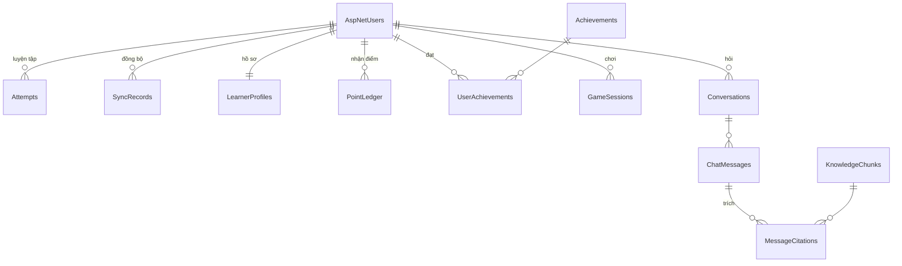

# Thiết kế cơ sở dữ liệu EnglishUp

Đề xuất cho đề tài "Xây dựng ứng dụng EnglishUp hỗ trợ học tiếng Anh với trợ giảng AI dựa trên RAG". Bảng đánh dấu **Đã có** nằm trong migration hiện tại; bảng **Đề xuất** sẽ được thêm theo lộ trình trong [PLAN.md](../PLAN.md) và có thể điều chỉnh khi cài đặt.

## 1. Nguyên tắc

- **Local-first.** Trình duyệt lưu dữ liệu học trong IndexedDB (Dexie) và học được khi không có mạng. PostgreSQL trên Supabase giữ bản của tài khoản, tính điểm, bảng xếp hạng và phục vụ trợ giảng.
- **Không tin dữ liệu từ trình duyệt.** Server kiểm tra mọi payload, tự tính điểm và tự chấm trò chơi.
- **Dữ liệu thuộc về người học.** Mọi bảng dữ liệu cá nhân có khoá ngoại tới `AspNetUsers` với `ON DELETE CASCADE`. Bảng xếp hạng chỉ hiện tên hiển thị của người đã đồng ý.
- **Không lưu âm thanh, không lưu khoá API** trong cơ sở dữ liệu. Khoá AI nằm trong user-secrets hoặc biến môi trường của server.
- **Nền tảng:** PostgreSQL do Supabase quản lý, truy cập qua EF Core 9 (Npgsql) từ API ASP.NET Core. Trình duyệt không gọi Supabase trực tiếp; chuỗi kết nối chỉ nằm ở server (user-secrets hoặc biến môi trường). Tìm kiếm vector dùng extension `pgvector` có sẵn trên Supabase. Không dùng Supabase Auth, REST tự sinh hay Row Level Security: ASP.NET Identity và API giữ toàn bộ quy tắc.

## 2. Tổng quan

| Nhóm                    | Bảng                                                                                                                            | Trạng thái              |
| ----------------------- | ------------------------------------------------------------------------------------------------------------------------------- | ----------------------- |
| Tài khoản               | `AspNetUsers`, `AspNetRoles`, `AspNetUserRoles`, `AspNetUserClaims`, `AspNetRoleClaims`, `AspNetUserLogins`, `AspNetUserTokens` | Đã có (`InitialCreate`) |
| Đồng bộ học tập         | `Attempts`, `SyncRecords`                                                                                                       | Đã có (`InitialCreate`) |
| Hồ sơ, điểm, thành tích | `PointLedger` đã có (`AddPoints`); `LearnerProfiles`, `Achievements`, `UserAchievements` đề xuất tuần 2                         | Đang làm, tuần 1–2      |
| Trò chơi                | `GameSessions`                                                                                                                  | Đề xuất, tuần 3         |
| Trợ giảng RAG           | `KnowledgeChunks`, `Conversations`, `ChatMessages`, `MessageCitations`                                                          | Đề xuất, tuần 5–6       |



## 3. Từ điển dữ liệu

Ký hiệu: PK khoá chính, FK khoá ngoại, NN không null, UQ duy nhất.

### 3.1 Tài khoản — Đã có

Do ASP.NET Identity tạo. Các cột dùng tới:

| Cột (`AspNetUsers`)               | Kiểu             | Ràng buộc                          | Ghi chú                            |
| --------------------------------- | ---------------- | ---------------------------------- | ---------------------------------- |
| `Id`                              | text             | PK                                 | GUID dạng chuỗi                    |
| `Email`, `NormalizedEmail`        | varchar(256)     | UQ (cấu hình `RequireUniqueEmail`) | Không hiện công khai               |
| `PasswordHash`                    | text             |                                    | Băm PBKDF2, không lưu mật khẩu gốc |
| `AccessFailedCount`, `LockoutEnd` | int, timestamptz |                                    | Khoá tạm khi nhập sai nhiều lần    |

Role, claim, login ngoài và token chưa dùng nhưng được Identity tạo sẵn.

### 3.2 `Attempts` — Đã có

Mỗi lượt luyện tập đã lưu. Tách cột để truy vấn điểm theo ngày và kỹ năng.

| Cột                | Kiểu             | Ràng buộc                       | Ghi chú                                                     |
| ------------------ | ---------------- | ------------------------------- | ----------------------------------------------------------- |
| `UserId`           | text             | PK, FK → `AspNetUsers`, cascade |                                                             |
| `Id`               | varchar(128)     | PK                              | UUID do trình duyệt sinh; gửi lại không tạo bản trùng       |
| `Skill`            | varchar(16)      | NN                              | `vocabulary`, `listening`, `speaking`, `reading`, `writing` |
| `Score`            | double precision | NN, 0–100 (kiểm tra ở API)      |                                                             |
| `Duration`         | double precision | NN, ≥ 0                         | Giây                                                        |
| `Timestamp`        | double precision | NN, ≥ 0                         | Mili-giây Unix từ JavaScript                                |
| `Label`            | varchar(500)     | NN                              | Tên bài/từ                                                  |
| `LearningLanguage` | varchar(8)       | null                            | `en`, `ja`, `zh`                                            |

Index: `IX_Attempts_UserId_Timestamp`.

### 3.3 `SyncRecords` — Đã có

Sáu kho Dexie còn lại (`settings`, `words`, `reviews`, `drafts`, `submissions`, `vocabularyStudy`), mỗi bản ghi lưu nguyên dạng JSON.

| Cột       | Kiểu             | Ràng buộc                       | Ghi chú                                                       |
| --------- | ---------------- | ------------------------------- | ------------------------------------------------------------- |
| `UserId`  | text             | PK, FK → `AspNetUsers`, cascade |                                                               |
| `Store`   | varchar(32)      | PK                              | Thuộc danh sách sáu kho                                       |
| `Id`      | varchar(128)     | PK                              | Khoá của bản ghi trong Dexie                                  |
| `Version` | double precision | NN, ≥ 0                         | `updated`, `lastReviewed` hoặc `timestamp`; bản cao hơn thắng |
| `Data`    | text             | NN, object JSON ≤ 200.000 ký tự | Client kiểm tra lại bằng Zod khi nhận về                      |

Lý do dùng JSON: server chỉ giữ hộ và gộp các kho này, không truy vấn bên trong; client thêm trường không cần migration. Khi cần truy vấn một trường (ví dụ số từ đã thuộc), tách kho đó thành bảng riêng giống `Attempts`.

### 3.4 `LearnerProfiles` — Đề xuất, tuần 2

| Cột                 | Kiểu        | Ràng buộc                       | Ghi chú                                                 |
| ------------------- | ----------- | ------------------------------- | ------------------------------------------------------- |
| `UserId`            | text        | PK, FK → `AspNetUsers`, cascade | Quan hệ 1–1                                             |
| `DisplayName`       | varchar(40) | NN                              | Mặc định "Học viên" + 4 ký tự ngẫu nhiên                |
| `ShowOnLeaderboard` | boolean     | NN, mặc định false              | Người học tự bật                                        |
| `TimeZone`          | varchar(64) | NN, mặc định `Asia/Ho_Chi_Minh` | Xác định "một ngày" cho giới hạn điểm và chuỗi ngày học |
| `CreatedAt`         | timestamptz | NN                              |                                                         |

### 3.5 `PointLedger` — Đã có (`AddPoints`)

Sổ ghi điểm: mỗi dòng là một lần cộng điểm. Tổng điểm và bảng xếp hạng đều tính từ bảng này nên luôn kiểm tra lại được.

| Cột         | Kiểu            | Ràng buộc                       | Ghi chú                                           |
| ----------- | --------------- | ------------------------------- | ------------------------------------------------- |
| `Id`        | bigint identity | PK                              |                                                   |
| `UserId`    | text            | NN, FK → `AspNetUsers`, cascade |                                                   |
| `Source`    | varchar(16)     | NN                              | `attempt`, `game`, `achievement`                  |
| `SourceId`  | varchar(128)    | NN                              | Id lượt luyện tập, Id ván chơi hoặc mã thành tích |
| `Points`    | int             | NN, > 0                         |                                                   |
| `LocalDate` | date            | NN                              | Ngày theo `TimeZone` của người học                |
| `CreatedAt` | timestamptz     | NN                              | Giờ server                                        |

- UQ (`UserId`, `Source`, `SourceId`): một nguồn chỉ được cộng điểm một lần, dù đồng bộ lại bao nhiêu lần.
- Index (`LocalDate`, `UserId`) INCLUDE (`Points`) cho bảng xếp hạng.

### 3.6 `Achievements` và `UserAchievements` — Đề xuất

| `Achievements`                   | Kiểu         | Ràng buộc | Ghi chú                                                         |
| -------------------------------- | ------------ | --------- | --------------------------------------------------------------- |
| `Code`                           | varchar(32)  | PK        | Ví dụ `first-attempt`, `streak-7`, `words-100`, `game-combo-10` |
| `TitleVi`, `TitleEn`             | varchar(80)  | NN        | Song ngữ theo quy ước giao diện                                 |
| `DescriptionVi`, `DescriptionEn` | varchar(200) | NN        |                                                                 |
| `Points`                         | int          | NN, ≥ 0   | Điểm thưởng khi đạt                                             |

Điều kiện đạt được viết trong code C# theo `Code`; bảng chỉ chứa phần hiển thị, nạp bằng seed data trong migration.

| `UserAchievements` | Kiểu        | Ràng buộc                       |
| ------------------ | ----------- | ------------------------------- |
| `UserId`           | text        | PK, FK → `AspNetUsers`, cascade |
| `AchievementCode`  | varchar(32) | PK, FK → `Achievements`         |
| `EarnedAt`         | timestamptz | NN                              |

### 3.7 `GameSessions` — Đề xuất

Trò chơi trắc nghiệm 60 giây. Server tạo đề và chấm, trình duyệt chỉ gửi câu trả lời.

| Cột                                     | Kiểu                     | Ràng buộc                       | Ghi chú                                                              |
| --------------------------------------- | ------------------------ | ------------------------------- | -------------------------------------------------------------------- |
| `Id`                                    | uuid                     | PK                              | Server cấp khi bắt đầu                                               |
| `UserId`                                | text                     | NN, FK → `AspNetUsers`, cascade |                                                                      |
| `Level`, `Topic`                        | varchar(32), varchar(64) | null                            | Bộ lọc người học chọn                                                |
| `QuestionsJson`                         | text                     | NN                              | Id từ, các lựa chọn và đáp án đúng; không gửi đáp án cho trình duyệt |
| `StartedAt`                             | timestamptz              | NN                              | Giờ server                                                           |
| `FinishedAt`                            | timestamptz              | null                            | Câu trả lời sau `StartedAt + 60 giây + 5 giây trễ mạng` bị bỏ        |
| `Correct`, `Total`, `MaxCombo`, `Score` | int                      | null cho đến khi chấm           |                                                                      |

Index (`UserId`, `StartedAt`) cho kỷ lục cá nhân và lịch sử chơi.

### 3.8 Trợ giảng RAG — Đề xuất

`KnowledgeChunks` chứa nội dung học của chính ứng dụng (từ vựng, bài đọc, bài nghe, giải thích), cắt thành đoạn ngắn kèm embedding.

| Cột              | Kiểu          | Ràng buộc | Ghi chú                                                     |
| ---------------- | ------------- | --------- | ----------------------------------------------------------- |
| `Id`             | int identity  | PK        |                                                             |
| `SourceType`     | varchar(16)   | NN        | `word`, `reading`, `listening`, `writing-guide`…            |
| `SourceId`       | varchar(128)  | NN        | Id trong file JSON nội dung, để mở đúng bài khi trích nguồn |
| `Title`          | varchar(200)  | NN        | Hiện trong phần nguồn trích dẫn                             |
| `Text`           | varchar(4000) | NN        | Một đoạn khoảng 100–300 từ                                  |
| `ContentHash`    | char(64)      | NN        | SHA-256 của `Text`; chỉ tạo lại embedding khi nội dung đổi  |
| `EmbeddingModel` | varchar(64)   | NN        | Đổi mô hình thì tạo lại embedding                           |
| `Embedding`      | vector(n)     | NN        | Kiểu của pgvector; n theo mô hình embedding                 |

- UQ (`SourceType`, `SourceId`, `ContentHash`).
- Ước tính vài nghìn đoạn; ví dụ 5.000 đoạn × 1.536 chiều × 4 byte ≈ 30 MB, pgvector tìm theo khoảng cách cosine ngay trong SQL; thêm index HNSW khi số đoạn lớn.

| `Conversations` | Kiểu        | Ràng buộc                       |
| --------------- | ----------- | ------------------------------- |
| `Id`            | uuid        | PK                              |
| `UserId`        | text        | NN, FK → `AspNetUsers`, cascade |
| `CreatedAt`     | timestamptz | NN                              |

| `ChatMessages`   | Kiểu            | Ràng buộc                         | Ghi chú                            |
| ---------------- | --------------- | --------------------------------- | ---------------------------------- |
| `Id`             | bigint identity | PK                                |                                    |
| `ConversationId` | uuid            | NN, FK → `Conversations`, cascade |                                    |
| `Role`           | varchar(16)     | NN                                | `user` hoặc `assistant`            |
| `Content`        | text            | NN                                | Câu hỏi giới hạn 2.000 ký tự ở API |
| `CreatedAt`      | timestamptz     | NN                                |                                    |

| `MessageCitations` | Kiểu             | Ràng buộc                        | Ghi chú                                     |
| ------------------ | ---------------- | -------------------------------- | ------------------------------------------- |
| `MessageId`        | bigint           | PK, FK → `ChatMessages`, cascade | Tin nhắn của trợ giảng                      |
| `ChunkId`          | int              | PK, FK → `KnowledgeChunks`       |                                             |
| `Rank`             | int              | NN                               | Thứ tự liên quan                            |
| `Score`            | double precision | NN                               | Độ tương đồng cosine, dùng khi đánh giá RAG |

## 4. Quy tắc nghiệp vụ gắn với dữ liệu

**Điểm (giá trị khởi đầu, chỉnh sau khi chạy thử):**

- Mỗi lượt luyện tập mới đồng bộ lên: `1 + floor(Score / 25)` điểm (1–5).
- Trò chơi: `10 × câu đúng + 5 × combo cao nhất`, do server chấm.
- Thành tích: cộng `Achievements.Points` một lần.
- Giới hạn 300 điểm mỗi `LocalDate` cho nguồn `attempt` và `game`, để không cày điểm bằng các lượt ngắn.
- Lượt có `Timestamp` cũ hơn 7 ngày khi đồng bộ vẫn được lưu nhưng không cộng điểm, để không nhập file sao lưu cũ lấy điểm.

**Bảng xếp hạng tuần** (không cần bảng riêng):

```sql
SELECT p."DisplayName", SUM(l."Points") AS points
FROM "PointLedger" AS l
JOIN "LearnerProfiles" AS p ON p."UserId" = l."UserId" AND p."ShowOnLeaderboard"
WHERE l."LocalDate" >= @week_start AND l."LocalDate" < @week_start + 7
GROUP BY l."UserId", p."DisplayName"
ORDER BY points DESC
LIMIT 50;
```

**Gợi ý cá nhân hoá** đọc trực tiếp từ dữ liệu đã có: kỹ năng có điểm trung bình thấp trong `Attempts`, số thẻ đến hạn trong bản ghi `reviews` của `SyncRecords`, chủ đề đang học trong `vocabularyStudy`. Không cần bảng mới.

## 5. Dữ liệu phía trình duyệt (Dexie)

Định nghĩa trong [storage.ts](../src/services/storage.ts): `settings`, `attempts`, `words`, `reviews`, `drafts`, `submissions`, `vocabularyStudy`. Điểm, thành tích, bảng xếp hạng và lịch sử trợ giảng **chỉ ở server**, không đưa vào Dexie hay file sao lưu, vì đó là dữ liệu do server quyết định.

## 6. Lộ trình migration

| Tuần | Migration                               | Bảng                                                                   |
| ---- | --------------------------------------- | ---------------------------------------------------------------------- |
| 1–2  | `InitialCreate`                         | `AspNet*`, `Attempts`, `SyncRecords` (đã có)                           |
| 1    | `AddPoints`                             | `PointLedger` (đã có)                                                  |
| 2    | `AddProfiles`                           | `LearnerProfiles`, `Achievements` (kèm seed), `UserAchievements`       |
| 3    | `AddGame`                               | `GameSessions`                                                         |
| 5–6  | `AddAssistant` (bật extension `vector`) | `KnowledgeChunks`, `Conversations`, `ChatMessages`, `MessageCitations` |

## 7. Hạn chế đã biết

- Đồng bộ không có bản ghi xoá (tombstone): xoá từ tự thêm hoặc đặt lại dữ liệu chỉ có tác dụng trên một thiết bị.
- Phiên bản bản ghi dựa vào đồng hồ của thiết bị; đồng hồ sai có thể làm bản cũ thắng.
- Mỗi lần đồng bộ trả toàn bộ dữ liệu tài khoản; cần con trỏ "từ thời điểm" khi lịch sử lớn.
- Tìm kiếm vector tính trong bộ nhớ của server, phù hợp vài nghìn đoạn nội dung, không phù hợp kho tài liệu lớn.
- Đăng xuất chưa thu hồi token phía server.
